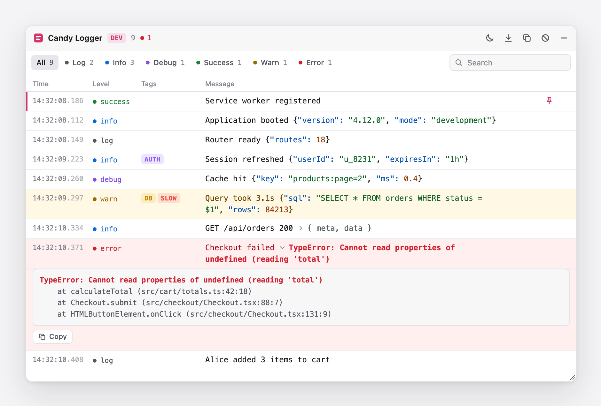

<picture>
  <source media="(prefers-color-scheme: dark)" srcset="https://raw.githubusercontent.com/shehari007/candy-logger/main/docs/panel-dark.png">
  
</picture>

# Candy Logger

[](https://www.npmjs.com/package/candy-logger)
[](https://www.npmjs.com/package/candy-logger)
[](LICENSE)

An in-page log panel for browser apps. Candy Logger copies `console` output into a
draggable, searchable table inside your page, so you can read logs where devtools are
awkward or missing: on a phone, in an embedded webview, during a demo, or in a screen
recording.

- **Logging can't throw.** Circular objects, `Error`s, `Map`, `Set`, `BigInt`, DOM nodes
  and getters that throw are all serialized safely. Your `console.log` call never fails
  because of what you passed it.
- **Small when unused.** The core is about 5 kB gzipped. The panel (about 14 kB) is
  loaded with a dynamic import only when you enable it.
- **Safe with untrusted data.** Everything is rendered with `textContent`, and it works
  under a strict Content Security Policy.
- **No dependencies.** ESM, CommonJS and a single `<script>` build, with TypeScript types.

**[Live demo](https://candy-logger.msyb.dev)** · [npm](https://www.npmjs.com/package/candy-logger) · [Changelog](CHANGELOG.md)

## Install

```bash
npm install candy-logger
```

## Quick start

```js
import { overrideConsole } from 'candy-logger';

overrideConsole({ enabled: import.meta.env.DEV });

console.log('Signed in', { userId: 42 });
console.error(new Error('Card declined')); // shown with its stack trace
```

Your existing `console` calls now appear in the panel, and still reach devtools with the
original objects. Gate `enabled` on your development flag so the panel never ships to
users. In webpack or Next.js that is `process.env.NODE_ENV !== 'production'`.

`overrideConsole()` is safe to call more than once, so React StrictMode and hot reloads
don't create a second panel.

## Usage

### A logger of your own

If you'd rather not touch `console`, create a logger and call it directly:

```js
import { createLogger } from 'candy-logger';

const log = createLogger({ enabled: true });

log.info('Config loaded', config);
log.success('Payment captured');
log.warn('Rate limit close', { remaining: 7 });
log.error('Request failed', err);
```

The levels are `log`, `info`, `debug`, `success`, `warn` and `error`.

### Recording without a panel

Logs are kept in memory whether or not the panel is showing. You can read them, or show
the panel later with everything already in it:

```js
import candy from 'candy-logger';

candy.log('recorded before any panel exists');
candy.getLogs();  // [LogEntry, ...]
candy.getStats(); // { all: 1, log: 1, info: 0, ... }

await candy.attachUI();
```

`candy` is a shared instance that is safe to import during server-side rendering.

### Tags

```js
log.tagged({ label: 'AUTH', color: '#8b5cf6', bg: 'rgba(139,92,246,.16)' }, 'info', 'Token refreshed');

log.tagged(
  [{ label: 'DB' }, { label: 'SLOW', color: '#ef4444' }],
  'warn',
  'Query took 3.1s',
  { sql },
);
```

Tags are searchable. Colors are checked against a short list of allowed CSS
properties, so a value that came from an API can't inject markup.

### Sending logs elsewhere

A sink receives every entry as it is logged. The panel is just one consumer of the
same store.

```js
const detach = log.addSink({
  write(entry) {
    if (entry.level === 'error') {
      navigator.sendBeacon('/api/client-errors', JSON.stringify(entry));
    }
  },
});
```

A sink that throws can't break the `console.log` call that triggered it.

### Without a bundler

```html
<script src="https://unpkg.com/candy-logger@2"></script>
<script>
  overrideConsole({ enabled: true });
</script>
```

The script build defines `candy`, `createLogger`, `overrideConsole`, `restoreConsole`
and `CandyLogger` on `window`.

### Frameworks

Call `overrideConsole()` once, as early as possible.

```js
// React (Vite): src/main.jsx
import { overrideConsole } from 'candy-logger';
overrideConsole({ enabled: import.meta.env.DEV });

// Next.js: in a client component rendered by your root layout
'use client';
import { overrideConsole } from 'candy-logger';
overrideConsole({ enabled: process.env.NODE_ENV !== 'production' });

// Vue: main.js, before createApp()
overrideConsole({ enabled: import.meta.env.DEV });

// Angular: main.ts, before bootstrapApplication()
overrideConsole({ enabled: !environment.production });
```

In Svelte or anywhere a component owns the logger, call `log.destroy()` when the
component unmounts. More complete examples are in [`examples/`](examples).

## The panel

- **Filter** by level with the buttons in the toolbar. Each shows a live count.
- **Search** matches the message, tags and the contents of logged objects, including
  collapsed ones. Press Escape to clear it.
- **Expand** an object or an error with the arrow next to it. Errors show their stack.
- **Pin** a row to keep it at the top. Pinned rows survive `clear()`, don't count
  toward `maxLogs`, and come back after a reload.
- **Drag** the header to move the panel, and the bottom-right corner to resize it.
  Double-click the header to minimize. Position, size and theme are remembered.
- **Export** the buffer as JSON, or copy every line as text.

On screens narrower than 640px the panel opens as a full-screen sheet.

## Options

```js
createLogger({ enabled: true, theme: 'auto', position: 'bottom-left' });
```

| Option | Type | Default | Description |
| --- | --- | --- | --- |
| `enabled` | `boolean` | `false` | Show the panel. Without it, logs are still recorded. |
| `theme` | `'dark' \| 'light' \| 'auto'` | `'dark'` | `'auto'` follows the system setting and updates when it changes. |
| `position` | `'bottom-right' \| 'bottom-left' \| 'top-right' \| 'top-left' \| 'full-bottom'` | `'bottom-right'` | Where the panel opens. `full-bottom` docks it across the bottom edge. |
| `maxLogs` | `number` | `500` | How many unpinned entries to keep. Older ones are dropped first. |
| `showTimestamp` | `boolean` | `true` | Show the Time column. |
| `tags` | `boolean` | `true` | Show the Tags column and the tag button on each row. |
| `collapsed` | `boolean` | `false` | Start minimized. |
| `dimWhenIdle` | `boolean` | `false` | Fade the panel until it is hovered or focused. |
| `badgeText` | `string` |  | A short label next to the title, such as `'DEV'` or `'STAGING'`. |
| `defaultTags` | `LogTag[]` | `[]` | Tags added to every entry. |
| `actions` | `LogAction[]` | `[]` | Extra buttons on each row. `onClick` receives the entry. |
| `persistPins` | `boolean` | `true` | Save pinned rows to `localStorage`. |
| `persistLayout` | `boolean` | `true` | Remember position, size, minimized state and theme. A saved value is ignored once you change the matching option. |
| `retainArgs` | `boolean` | `false` | Keep references to the original arguments on each entry. Off by default so logged objects can be garbage collected. |
| `maxDepth` | `number` | `8` | How deep nested objects are captured. |
| `maxString` | `number` | `1000` | Characters kept per string inside a logged object. |
| `nonce` | `string` |  | Nonce for the injected `<style>` tag, if your CSP requires one for styles. |

`forceUI` from earlier versions is still accepted as an alias for `enabled`.

## API

```ts
// Logging
log.log(...args)   log.info(...args)   log.debug(...args)
log.success(...args)   log.warn(...args)   log.error(...args)
log.tagged(tag | tag[], level, ...args)

// Data (works with or without a panel)
log.getLogs(): LogEntry[]
log.getStats(): Record<LogLevel | 'all', number>
log.clear(options?: { includePinned?: boolean })

// Panel
await log.attachUI(options?)
log.detachUI()
log.showPanel()
log.hidePanel()

// Console
log.captureConsole(): () => void   // returns a function that undoes it
overrideConsole(options?): CandyLogger
restoreConsole()
isConsoleOverridden(): boolean

// Other
log.addSink(sink): () => void
log.destroy()   // removes the panel, its listeners and sinks, and restores console
```

The serializer is exported too, if you want safe stringification on its own:

```ts
import { safeStringify, serializeError, formatArgs } from 'candy-logger';

safeStringify(anything);  // { text, truncated }, never throws
serializeError(err);      // { name, message, stack: string[], cause?, ...ownProps }
formatArgs(['%s: %d', 'hits', 42]);
```

Types are included:

```ts
import type { LogEntry, LogLevel, LogTag, LogAction, Sink, CandyLoggerOptions } from 'candy-logger';
```

## Security

- **Keep the panel out of production.** Gate `enabled` on a development flag. Anything you
  log stays in memory, where any script on the page can read it.
- **Pinned rows are written to `localStorage`** as plain text so they survive a reload.
  Don't pin rows that contain tokens or personal data, or set `persistPins: false`. Raw
  arguments are never stored, and stored pins are capped at 64 kB.
- **Log data is never parsed as HTML.** Messages, object keys, tag labels and action labels
  are rendered as text. Tag colors and `%c` styles go through an allowlist of CSS properties.
- **No inline scripts or event handlers**, so the panel works with `script-src 'self'`. If
  your policy also restricts styles, pass a `nonce`.

## Browser support

Current versions of Chrome, Edge, Firefox and Safari (Chrome 88+, Firefox 78+, Safari 14.1+).
The logger itself runs anywhere ES2020 does, including Node, but the panel needs a DOM.

## Development

```bash
npm install
npm run build      # ESM, CJS and IIFE bundles in dist/
npm test           # 134 tests, run against happy-dom
npm run typecheck
npm run demo       # builds, then serves the demo page at http://localhost:4321
```

Issues and pull requests are welcome. Please add a test for any change in behaviour.

## License

[MIT](LICENSE) © Muhammad Sheharyar Butt

The Systronium Technologies name and logo are trademarks of Systronium Technologies and are
not covered by the MIT license.

---

<a href="https://systronium.com"></a>&nbsp; Powered by **[Systronium Technologies](https://systronium.com)**
